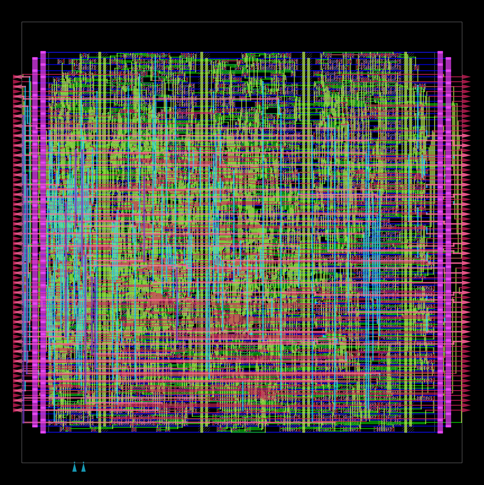
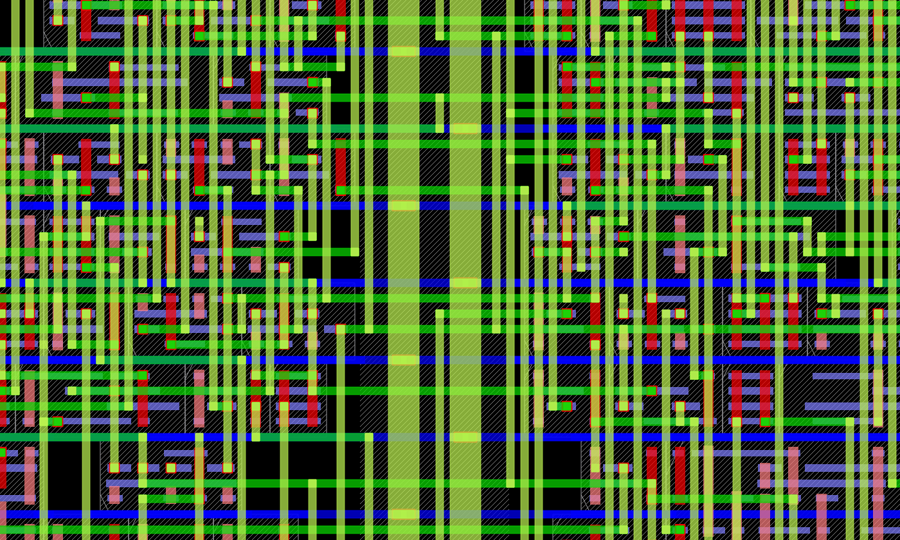
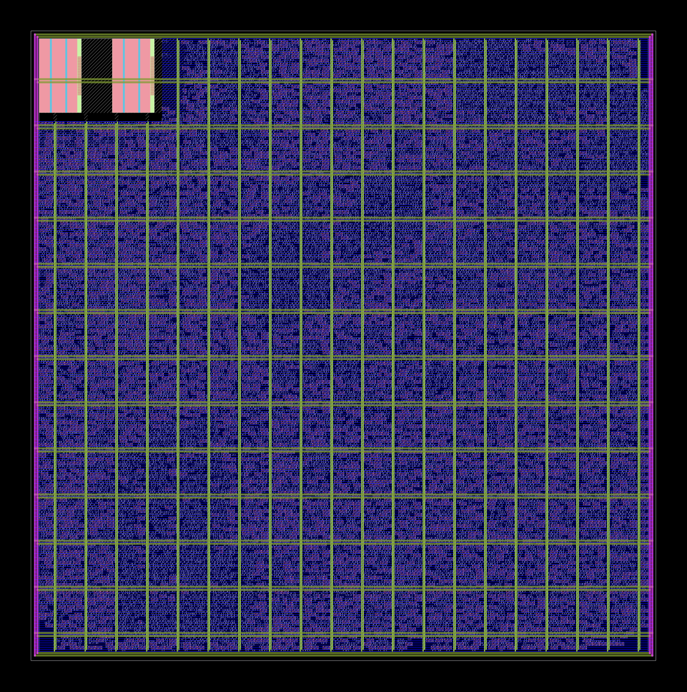
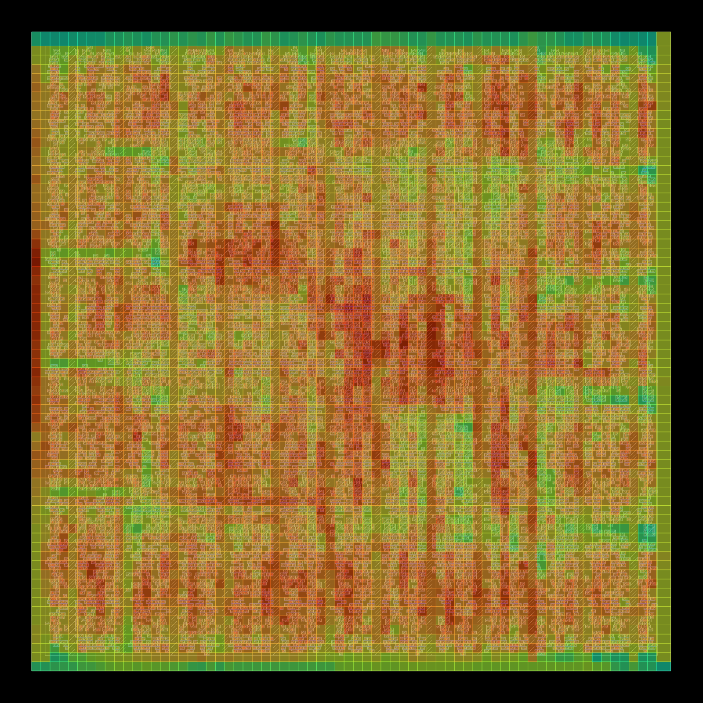
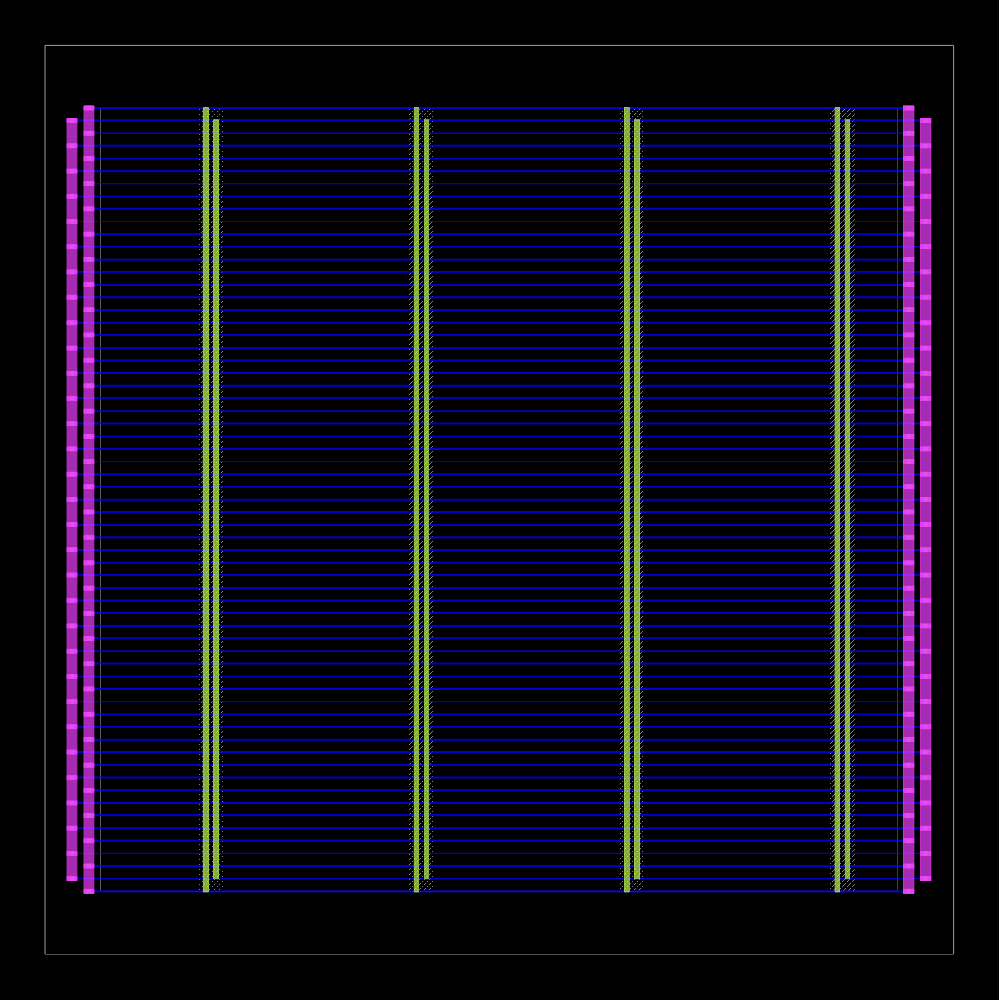
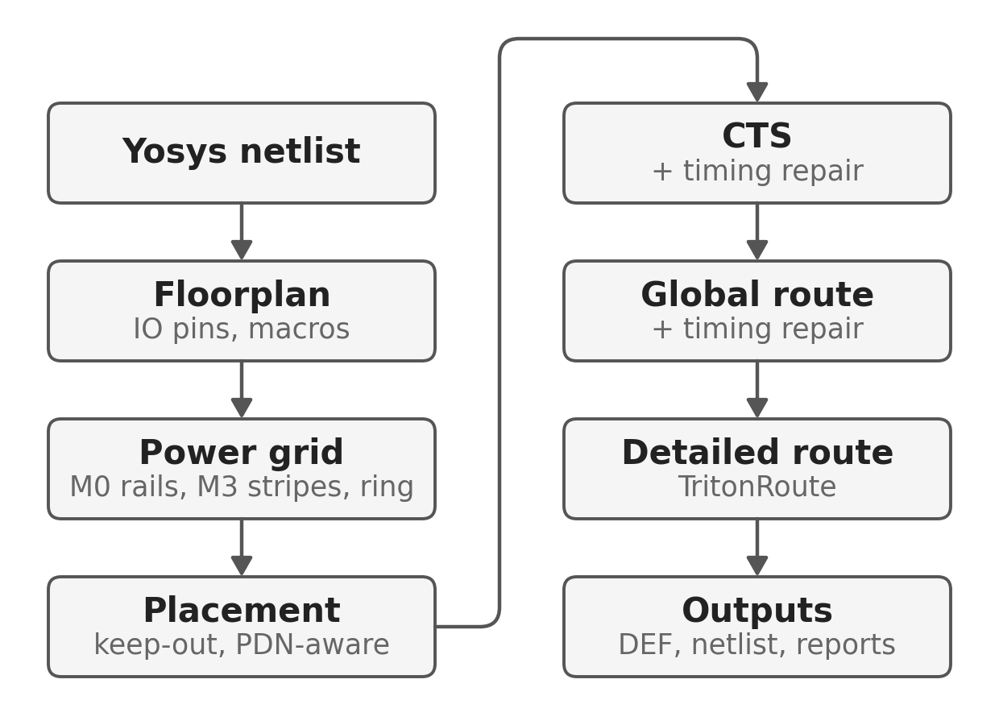
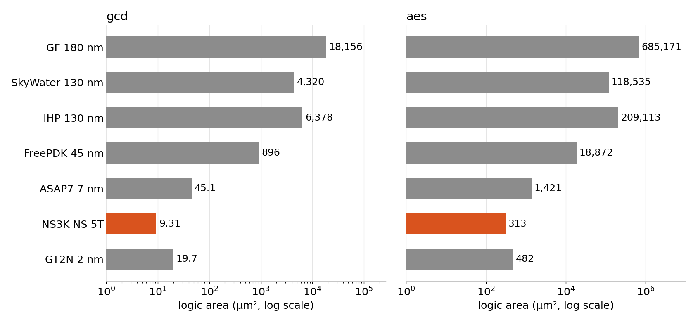

<div align="center">

# i3dPDK_NS3K × OpenROAD

**An open-source RTL-to-layout flow for a 3 nm-class predictive nanosheet PDK:<br/>
5-track GAAFET cells, 44 nm sites, 24 nm M2 pitch, strictly unidirectional M2–M4.**

[](https://github.com/The-OpenROAD-Project/OpenROAD)
[](#acknowledgements)
[](#the-platform)
[](#the-platform)



<sub><b>SERV</b> (bit-serial RISC-V), placed and routed on the <b>NS3K_5T</b> library: 8.6 × 8.6 µm, 1,175 cells, <b>0 DRC</b>, clean power grid.</sub>

**[Quick start](#quick-start)** · [Gallery](#gallery) · [The flow](#the-flow) · [Results](#results) · [Technology roadmap](#technology-roadmap) · [Open problems](#open-problems) · [FAQ](#faq)

</div>

---

## Why this exists

Academic placement and routing research mostly runs on 45 nm (Nangate45), 130 nm
(SKY130) or 7 nm (ASAP7) libraries. At those nodes a standard-cell pin can be reached
in many ways. At 3 nm it cannot: the metal pitches are close to the via size, the
lowest metals are printed in one direction only, and the power grid takes a large
share of the tracks that pins need.

i3dPDK_NS3K is a predictive 3 nm-class nanosheet PDK with a 5-track standard-cell
library. This repository is a complete, scriptable **OpenROAD** flow for it:

- **One command** from a Yosys netlist to a routed DEF, with timing, power, DRC and power-grid reports.
- **Real geometry (1×)**: 44 nm sites, 120 nm rows, 24 nm M2 pitch, 22 nm M3 pitch, M0 power rails.
- **Strictly unidirectional M2–M4** (`RIGHTWAYONGRIDONLY` + `RECTONLY`), as printed at this node: no wrong-way jogs, no off-track wires.
- **A power grid that routes**: M3 VDD/VSS stripe pairs tied to every rail, a core ring, and a placement keep-out under the stripes, without which the detailed router stalls next to them under unidirectional M2 (gcd: 12 violations after 20 iterations and 50 min, vs. 0 in 1.7 min).
- **Hard macros** (abstract SRAMs) placed by RTL-MP, with their own power grid.
- **12 benchmark designs** included as netlists (gcd, SERV, AES, RISC-V, Rocket, SweRV, BlackParrot, …).
- **No commercial tool license, no GUI.** Everything runs in the OpenROAD docker image, layout snapshots included.

### Where it stands

| | Result |
|---|---|
| Floorplan → detailed route, **9 of 12** designs (gcd, SERV, AES, riscv32i, dynamic_node, jpeg, tinyRocket, ethmac, bp_fe_top) | **0 DRC**, power grid clean |
| Largest routed design | jpeg, 64,369 cells, 55.4 × 55.4 µm, 0 DRC |
| Not closed yet | bp_be_top, swerv, swerv_wrapper (no finished detailed route yet; see [Open problems](#open-problems)) |
| Timing | gcd, AES meet 1.0 ns after routing; the others don't (see [Results](#results)) |

## Gallery

<table>
<tr>
<td width="50%"></td>
<td width="50%"></td>
</tr>
<tr>
<td><sub><b>An M3 stripe pair</b> (SERV, close-up). The two olive bands are the VDD/VSS stripes, the blue lines the M0 rails they are tied to. No cell sits under them or next to them: that is the placement keep-out (<code>PG_M3_KEEPOUT_SITES</code>).</sub></td>
<td><sub><b>tinyRocket</b> (Rocket tile with SRAM macros, 30,280 cells, 40.7 × 40.9 µm) after placement. The macros sit in the top-left corner, rows are cut around them, and the M3 stripe grid covers the standard cells.</sub></td>
</tr>
<tr>
<td></td>
<td></td>
</tr>
<tr>
<td><sub><b>AES</b> global-routing congestion (11,421 cells, 25 × 25 µm). Red is dense; the detailed router still finishes with 0 DRC.</sub></td>
<td><sub><b>Power grid</b> of SERV: M0 rails (blue) tied to M3 VDD/VSS stripe pairs (olive, every 2 µm) and to the core ring (magenta).</sub></td>
</tr>
</table>

## Results

Every design below is routed with the flow's defaults (`scripts/run_or.sh <design> NS3K_5T`),
clock period 1.0 ns (SERV: 0.25 ns), up to 64 detailed routing iterations. Numbers come from
`python3 scripts/summarize.py --md`.

| Design | Cells | Die (µm) | Util. | Setup WNS (ns) | Hold WNS (ns) | Power (mW) | DRC | PG | Runtime |
|---|---|---|---|---|---|---|---|---|---|
| gcd | 276 | 4.8 × 4.8 | 0.66 | +0.497 | +0.019 | 0.32 | **0** | clean | 4 min |
| serv | 1,175 | 8.6 × 8.6 | 0.73 | −0.048 | −0.011 | 8.5 | **0** | clean | 9 min |
| riscv32i | 9,607 | 28.4 × 28.5 | 0.52 | −0.797 | −0.039 | 12.5 | **0** | clean | 57 min |
| aes | 11,421 | 25.0 × 25.0 | 0.55 | +0.266 | −0.023 | 13.5 | **0** | clean | 46 min |
| dynamic_node | 11,788 | 29.3 × 29.3 | 0.65 | −0.126 | −0.004 | 21.1 | **0** | clean | 14 min |
| tinyRocket | 30,280 | 40.7 × 40.9 | 0.63 | −0.504 | −0.047 | 40.0 | **0** | clean | 33 min |
| bp_fe_top | 30,030 | 71.4 × 71.7 | 0.33 | −3.291 | −0.127 | 61.6 | **0** | clean | 119 min |
| jpeg | 64,369 | 55.4 × 55.4 | 0.63 | −0.365 | −0.062 | 50.8 | **0** | clean | 27 min |
| ethmac | 54,874 | 57.6 × 57.6 | 0.64 | −0.211 | −0.060 | 83.6 | **0** | clean | 41 min |

Cells exclude macros; utilization is of the standard cells in the die. Timing and power use the placeholder wire R/C of the tech LEF and are
estimates, see [The platform](#the-platform). The clock periods are targets, not tuned:
a negative WNS says the design needs a longer period, or work on timing, not that routing failed.

## Quick start

You need **docker** and **git**. OpenROAD, Yosys and the RTL of the benchmark designs all
come in the official [OpenROAD-flow-scripts image](https://hub.docker.com/r/openroad/orfs),
pinned in [`scripts/docker_env.sh`](scripts/docker_env.sh) and pulled on first use.
Python 3 with matplotlib and Pillow is only needed for the plots.

```bash
git clone https://github.com/i3dknu1/i3dPDK_NS3K
cd i3dPDK_NS3K
git clone https://github.com/RayChang987/openroad-i3dpdk-ns3k ns3k_openroad_enablement
cd ns3k_openroad_enablement

scripts/run_or.sh gcd NS3K_5T                              # ~4 min, ends with 0 DRC
env UTIL=0.5 OUT_TAG=u50 scripts/run_or.sh aes NS3K_5T     # any parameter as an env variable
python3 scripts/summarize.py                               # one line per run (--md for markdown)
```

If this repository lives somewhere else, set `PDK_ROOT=/path/to/i3dPDK_NS3K`. To use your
own OpenROAD build, set `OR_IMAGE` (an image its binary runs in) and `OR_BIN` (the
binary, under `$HOME` or this repository). The results below were made with OpenROAD
`687848d` built in `openroad/ubuntu26.04-dev:47319c`; each run records the image and
binary it used in `flow_version`.

### Your own designs

Netlists are included for all 12 designs. [`scripts/syn.sh`](scripts/syn.sh) runs Yosys
in the same image, and `run_or.sh` picks up its result when a design has no included
netlist (otherwise pass `NETLIST`):

```bash
scripts/syn.sh aes NS3K_5T           # -> out/aes/NS3K_5T/syn/aes_cipher_top.v.gz
env NETLIST=$PWD/out/aes/NS3K_5T/syn/aes_cipher_top.v.gz scripts/run_or.sh aes NS3K_5T
```

A new design needs two files: `designs/<name>/config.tcl` (top module, clock port and
period, utilization, SRAM macros) and `designs/<name>/rtl.tcl` (the RTL file list). The
ORFS designs read their RTL from the image. SERV needs a clone of
[olofk/serv](https://github.com/olofk/serv), see [`designs/serv/rtl.tcl`](designs/serv/rtl.tcl).
The included netlists were made by the same Yosys script with Yosys 0.44; the image's
newer Yosys gives netlists within a few percent of them (gcd: 256 vs. 263 cells).

### What a run writes

Every run writes `out/<design>/<LIB>/<tag>/`:

| File | Contents |
|---|---|
| `metrics.json`, `rpt/summary.txt` | die, cells (without macros), utilization, WNS/TNS, power, wirelength, DRC count, power-grid status |
| `rpt/{place,cts,grt,final}.rpt` | timing / area / power / DRV per stage |
| `rpt/drc.rpt`, `rpt/pg_*.rpt` | remaining DRC (TritonRoute format), `check_power_grid` results |
| `<top>.def`, `<top>.pnr.v`, `<top>.floorplan.def` | final layout, netlist, floorplan with the PDN |
| `{floorplan,place,cts,grt,route}.odb` | database after each stage |
| `run_params.json`, `openroad.log` | parameters in effect, flow version, full log |

To look at a result interactively, `scripts/gui.sh out/serv/NS3K_5T/base/route.odb`
opens it in OpenROAD's web viewer (forward port 8765 from a remote host; `GUI=x11` for the
Qt GUI over `ssh -X`). Snapshots and plots like the ones above:

```bash
env SNAP_ODB=out/serv/NS3K_5T/base/route.odb SNAP_PNG=serv.png \
    OR_ENV="SNAP_ODB SNAP_PNG" scripts/openroad.sh -gui -no_init -exit scripts/snapshot.tcl
python3 scripts/plot_drt.py drt.png out/gcd/NS3K_5T/base:gcd out/serv/NS3K_5T/base:serv
```

`snapshot.tcl` also takes `SNAP_AREA`, `SNAP_RES`, `SNAP_LAYERS` and
`SNAP_VIEW=route|place|pdn|congestion`.

## The flow



| Stage | What happens |
|---|---|
| read | tech LEF (`_unidir` variant by default), cell LEF, macros, liberty, netlist; SDC with IO delays at 20 % of the period; wire RC per layer from the LEF |
| floorplan | no macros: `initialize_floorplan` at `UTIL`. With macros: the core is sized by shelf-packing the macros (with halos and logic channels) and scanning the aspect ratio, then `rtl_macro_placer` places them and `cut_rows` clears the rows under them. M1–M3 tracks are laid out from the core origin, through the pins |
| power grid | pdngen: core ring (M9 sides; M8 sides too with macros), M0 follow-pin rails extended to it, M3 stripe pairs, M8 stripes and macro grids with macros; `check_power_grid` must pass |
| placement | keep-out under the M3 stripe pairs, `global_placement -timing_driven -routability_driven`, `repair_design`, `detailed_placement -pdn_aware`, `optimize_mirroring` |
| CTS | `clock_tree_synthesis` (BUF_X1–X8), `repair_clock_nets`, setup + hold `repair_timing` |
| global route | `global_route`, then `repair_timing` inside `-start_incremental` / `-end_incremental`, with the new buffers legalized |
| detailed route | `detailed_route`, up to `DRT_END_ITER` iterations |

Clocks are routed on M4 and above: M2/M3 have about 7× the resistance of M4 at this node
(0.67 vs 0.1 kΩ/µm), enough clock skew after routing for hold repair to run out of buffers.

### Tracks through the pins

Every signal pin is a 16 nm wide vertical M1 bar in the middle of a site, spanning most
of the 120 nm row. The flow rebuilds the M1–M3 track grids from the core origin, so that

- M1 (44 nm) and M3 (22 nm) tracks pass through the site centres, where the pins are;
- M2 tracks (24 nm, five per row) sit on the row boundaries and 1–4 pitches above them.
  The rails are on M0, so all four inner M2 tracks cross every pin, also the short ones
  (16 nm tall, such as `DFF_X1/D`).

The LEF's own offsets leave short pins without an on-grid M2 track, which matters when
only on-grid wires are allowed (`PIN_ALIGNED_TRACKS=0` brings them back).

### Parameters

Per-design defaults live in `designs/<design>/config.tcl`. Any of them, and any flow
parameter below, can be overridden with an environment variable of the same name.

| Parameter | Default | Meaning |
|---|---|---|
| `CLK_PERIOD_NS` | 1.0 | clock period (also the 3rd argument of `run_or.sh`) |
| `UTIL` | 0.6 | core utilization of the standard cells |
| `PLACE_DENSITY` | UTIL + 0.1 | global placement target density |
| `CORE_MARGIN_UM` | 0.5 | die-to-core margin (holds the ring) |
| `IO_PIN_LAYERS` / `IO_PIN_TRACKS` | 4 / 4 | IO pins on M4/M6/M8/M10 and M5/M7/M9/M11, one every N tracks |
| `MACRO_HALO_UM` | 0.5 | macro halo |
| `MIN_CHANNEL_UM` / `MPL_CHANNEL_UM` | 10 / 4 | logic channel when sizing the core / minimum gap between macro edges with pins (RTL-MP) |
| `MACRO_AREA_SLACK` | 1.25 | area margin for the macros when sizing the core |
| `MIN_ROW_UM` | M3 pitch + 3 × width | shortest row piece kept after cutting rows around macros |
| `PG_M3_PITCH_UM` / `PG_M3_WIDTH_UM` | 2.0 / 0.048 | M3 power stripe pairs (pitch 0 = none) |
| `PG_M3_KEEPOUT_SITES` | 1 | no cells under an M3 stripe pair nor within N sites of it (-1 = off) |
| `PG_MACRO_PITCH_UM` | 3.0 | M8 stripe pitch over macro designs |
| `PG_CHECK_ABORT` | 1 | stop if the power grid is not clean after the PDN |
| `SIGNAL_TOP_LAYER` / `CLOCK_LAYERS` | M11 / M4–M11 | routing layers |
| `ROUTE_UNIDIR` | 1 | M2–M4 preferred direction only, on track (`RIGHTWAYONGRIDONLY` + `RECTONLY`); 0 = bidirectional |
| `PIN_ALIGNED_TRACKS` | 1 | M1–M3 tracks from the core origin, through the pins |
| `GPL_TIMING` / `GPL_ROUTABILITY` | 1 / 1 | global placement modes |
| `GRT_ADJUST` / `GRT_ADJUST_M23` | 0.3 / 0.3 | global routing capacity reduction (M4+ / M2–M3) |
| `CELL_PAD_SITES` | 0 | free sites around each cell during placement |
| `REPAIR_TIMING` / `REPAIR_MAX_BUFFER_PCT` | 1 / 50 | timing repair after CTS and global routing, and its buffer budget |
| `DRT_END_ITER` | 64 | detailed routing iterations |
| `THREADS` | 16 | |
| `STOP_AFTER` | — | `floorplan` / `place` / `cts` / `grt`: write results after that stage and exit |
| `NETLIST` | `designs/<d>/<LIB>/<top>.v.gz` | netlist to use instead |
| `TECH_LEF` | `platform/lef/…` | tech LEF to use instead |
| `OUT_TAG` | base | run name |

## The platform

| Library | Device | Tracks | Row height | Site | Cells |
|---|---|---|---|---|---|
| `NS3K_5T` | nanosheet (GAAFET) | 5 | 120 nm | 44 nm | 50 (INV/BUF X1–X32, NAND/NOR/AOI/OAI, XOR, MUX, FA/HA, DFF) |

Metal stack: M0 … M16 (M2/M4 at a 24 nm pitch, M3 at 22 nm, M1 at 44 nm); liberty at 0.7 V, TT, 27 °C.

`platform/` holds everything this flow needs beyond the PDK's liberty file:

- `lef/i3dPDK_NS3K_5T_tech[_unidir].lef`: technology LEFs derived from the PDK's `TECH/i3dPDK_NS3K_5T_mw.tf`. The `.tf` has no preferred routing directions, no wire R/C and no via resistance, so those are **placeholders**: M1 vertical, alternating above it; R/C as rough 3 nm-class estimates; via R per cut layer. Timing and power are therefore estimates, good for comparisons between runs, not signoff. The `_unidir` variant adds `LEF58_RIGHTWAYONGRIDONLY` and `LEF58_RECTONLY` to M2–M4. The tech section of the PDK's own cell LEF is not used: its M2/M3 pitches disagree with the `.tf`.
- `lef/NS3K_5T_cells.lef`: the PDK cell LEF with the multi-row cells (DFF, FA, HA, MUX2_X2, XOR2_X2, …, two rows high) on the regular row site; the placer picks rows of matching rail polarity from their M0 rail pins. `NAND2_X1` repeats its VDD rail in its M0 obstruction (a short with the rail in every instance); that copy is dropped.
- `macros/`: abstract single-port SRAMs (LEF + liberty) with the pin interface of OpenROAD-flow-scripts' `fakeram`, M4 pins and M5 power straps. Their area, pins and timing are assumptions, not PDK data.

`designs/` holds the Yosys netlists (gzip) of 12 designs: 11 from
[OpenROAD-flow-scripts](https://github.com/The-OpenROAD-Project/OpenROAD-flow-scripts)
plus SERV. The PDK has no TIE cells, so constants are tied logically to VDD/VSS. It has
no delay cells either, so hold is fixed with buffer chains.

## Technology roadmap

The same RTL through OpenROAD on six open PDKs from
[OpenROAD-flow-scripts](https://github.com/The-OpenROAD-Project/OpenROAD-flow-scripts)
(including the ones packaged in [lambdapdk](https://pypi.org/project/lambdapdk/)) and on
i3dPDK_NS3K, all in the same image. Each ORFS platform uses its own reference setup
(clock, utilization); the NS3K runs use a clock close to what the library reaches
(gcd 0.5 ns, aes 0.8 ns).



<sub>Logic area of gcd and aes. Grey: the ORFS platforms. Orange: NS3K with this flow.</sub>

On area, the 5-track nanosheet library sits between ASAP7 and GT2N for aes (313 µm²,
vs. 1,421 and 482) and below both for gcd. On speed it does not: aes reaches 1.4 GHz,
about half of ASAP7 and GT2N. These are single example runs, not a calibrated
comparison, so check them against your own settings before quoting them.

<details>
<summary><b>Full numbers: clock, Fmax, area, wirelength, power, energy</b></summary>

**gcd**

| Platform | Clock (ns) | Fmax (GHz) | Logic area (µm²) | Die (µm²) | Wirelength (µm) | Power (mW) | Energy / cycle (pJ) | DRC |
|---|---|---|---|---|---|---|---|---|
| GF 180 nm | 3 | 0.27 | 18,156 | 26,677 | 14,912 | 47 | 141 | 0 |
| SkyWater 130 nm | 1.1 | 0.43 | 4,320 | 6,404 | 7,425 | 5.29 | 5.82 | 0 |
| IHP 130 nm | 1.5 | 0.59 | 6,378 | 34,648 | 10,930 | 3.01 | 4.52 | 0 |
| FreePDK 45 nm | 0.25 | 2.40 | 896 | 1,278 | 4,421 | 3.85 | 0.963 | 0 |
| ASAP7 7 nm | 0.31 | 3.18 | 45.1 | 79 | 812 | 0.64 | 0.199 | 0 |
| **NS3K NS 5T** | 0.5 | 2.48¹ | 9.31 | 23.5 | 467 | 0.642¹ | 0.321¹ | 0 |
| GT2N 2 nm | 0.17 | 4.48 | 19.7 | 78.9 | 713 | 0.677 | 0.115 | 0 |

**aes**

| Platform | Clock (ns) | Fmax (GHz) | Logic area (µm²) | Die (µm²) | Wirelength (µm) | Power (mW) | Energy / cycle (pJ) | DRC |
|---|---|---|---|---|---|---|---|---|
| GF 180 nm | 3 | 0.27 | 685,171 | 1,008,080 | 1,129,235 | 2,475 | 7,425 | 0 |
| SkyWater 130 nm | 3.6 | 0.27 | 118,535 | 225,806 | 571,574 | 70 | 252 | 0 |
| IHP 130 nm | 2 | 0.40 | 209,113 | 284,073 | 627,422 | 75.5 | 151 | 0 |
| FreePDK 45 nm | 0.82 | 1.21 | 18,872 | 62,612 | 223,732 | 47.6 | 39 | 0 |
| ASAP7 7 nm | 0.38 | 2.49 | 1,421 | 2,373 | 50,810 | 18.9 | 7.18 | 0 |
| **NS3K NS 5T** | 0.8 | 1.40¹ | 313 | 627 | 32,046 | 16.7¹ | 13.4¹ | 0 |
| GT2N 2 nm | 0.35 | 2.77 | 482 | 1,743 | 37,296 | 7.68 | 2.69 | 0 |

Logic area counts buffers, inverters, flops and combinational cells, without fill, tap
or endcap cells. Energy per cycle is power × clock period. NS3K and GT2N are at 0.7 V
typical; GF 180 nm is at its fast corner (1.98 V, 125 °C), which explains its power.

¹ NS3K timing and power use placeholder wire R/C (see [The platform](#the-platform)).
They're good for comparing NS3K runs with each other, rough against other PDKs. The cell
area is the PDK's own.

To reproduce:

```bash
scripts/orfs_ref.sh gt2n aes                      # any ORFS platform / design, into out/_orfs/
env OUT_TAG=p800 scripts/run_or.sh aes NS3K_5T 0.8
env OUT_TAG=p500 scripts/run_or.sh gcd NS3K_5T 0.5
python3 scripts/roadmap.py --plot                 # table, docs/roadmap/results.json, figure
```

</details>

## Open problems

Contributions and ideas are very welcome. These are open research questions as much as
engineering tasks.

### 1. Three designs without a finished route

bp_be_top, swerv and swerv_wrapper (the three with the most macros and the largest
netlists) are not in the results above: no run of them has finished detailed routing yet.
Earlier attempts were still reporting thousands of violations when they were stopped,
and the 12 % stripe keep-out, the macro channels and plain run time are all candidates.
Which one it is is not known yet.

### 2. Timing closure

Only gcd and AES meet the 1.0 ns target after routing, and hold slack is slightly negative
on 8 of the 9 routed designs. bp_fe_top misses by 3.3 ns. The flow repairs setup and hold
after CTS and global routing, but a 3 nm-class library with no delay cells leaves it
little to work with: hold is fixed with buffer chains.

### 3. Parasitics

The `.tf` has no wire R/C. The values in the tech LEF are placeholders, and there is no
OpenRCX extraction deck for this PDK, so final timing uses global-route estimates.

### 4. The keep-out costs area

The M3 stripe keep-out removes about 12 % of the row width. Shorter stripe pitches or
stripes on a higher metal could give some of it back; neither is evaluated here.

## FAQ

**Can OpenROAD place and route a 3 nm-class nanosheet library with unidirectional metals?**
Yes. With this flow 9 of the 12 included designs, up to 64,000 cells, reach 0 DRC on
`NS3K_5T` with M2–M4 strictly unidirectional and on-track. See [Results](#results).

**How are the M0 power rails handled?**
pdngen builds follow-pin rails on M0, extends them to a core ring, and ties them to M3
VDD/VSS stripe pairs through via stacks. `check_power_grid` runs right after the PDN (the
run stops if the grid isn't clean) and again after routing.

**How does a 3 nm-class nanosheet library compare with other open PDKs?**
Same RTL, same image, seven platforms from 180 nm to 2 nm: [Technology roadmap](#technology-roadmap).

**Is this usable for sign-off or fabrication?**
No. The PDK is predictive and academic, wire R/C and macros are placeholders, and the
license excludes commercial use.

<sub>Keywords: OpenROAD, OpenROAD-flow-scripts (ORFS), Yosys, TritonRoute, i3dPDK_NS3K, 3 nm, nanosheet, GAAFET,
gate-all-around, unidirectional routing, power stripes, standard cells, RTL-to-layout, physical design,
place and route, predictive PDK, EDA, open-source EDA.</sub>

## Repository layout

```
├── LICENSE                CC BY-NC-SA 4.0 (the whole repository)
├── flow/
│   ├── flow.tcl           main flow (read → floorplan → PDN → place → CTS → route → reports)
│   ├── floorplan.tcl      core sizing, pin-aligned tracks, IO pins, macro placement, row cutting
│   ├── pdn.tcl            power grid (pdngen)
│   ├── util.tcl           parameters, wire RC, M3 stripe keep-outs, reports, power-grid checks
│   └── syn.tcl            Yosys synthesis (run by scripts/syn.sh)
├── platform/
│   ├── lef/               tech LEFs (bi- and unidirectional), cell LEF
│   ├── macros/            abstract SRAM LEF + liberty
│   └── dont_use.tcl       cells no step may use (synthesis, CTS, repair)
├── designs/<design>/      config.tcl, rtl.tcl (RTL for syn.sh) and <LIB>/<top>.v.gz
├── scripts/
│   ├── run_or.sh          run one design:  [env VAR=...] run_or.sh <design> <LIB> [period_ns]
│   ├── syn.sh             synthesize one design:  syn.sh <design> <LIB> [period_ns]
│   ├── openroad.sh        OpenROAD in its docker image
│   ├── docker_env.sh      the image (pinned) and its mounts, for openroad.sh, syn.sh, gui.sh
│   ├── gui.sh             open a database in OpenROAD's web viewer (or the X11 GUI)
│   ├── export_odb.tcl     DEF + Verilog of a saved database (e.g. cts.odb)
│   ├── summarize.py       table of all runs
│   ├── orfs_ref.sh        ORFS reference run on another platform (for the roadmap)
│   ├── roadmap.py         technology roadmap table, json and figure
│   ├── plot_flow.py       the flow diagram
│   ├── snapshot.tcl       headless layout images
│   └── plot_drt.py        detailed routing convergence plot
└── docs/images/
```

## License

This repository is licensed under
[**CC BY-NC-SA 4.0**](https://creativecommons.org/licenses/by-nc-sa/4.0/) (see [LICENSE](LICENSE)),
the same license as i3dPDK_NS3K, from which the files in `platform/` are derived.
Like the PDK, it is for education and academic research only: not for commercial use,
and not for fabrication. If you use it, please also cite the PDK:

> Taigon Song, "i3dPDK_NS3K_v1.1", I3DVLSI Laboratory, Kyungpook National Univ., 2026.
> Available at: https://github.com/i3dknu1/i3dPDK_NS3K

The benchmark netlists in `designs/` are synthesized from RTL in OpenROAD-flow-scripts
and SERV; the original designs keep their own licenses.

## Acknowledgements

- **i3dPDK_NS3K v1.1**, Prof. Taigon Song, I3D VLSI Lab, Kyungpook National University.
  The files in `platform/` are derived from it; they are not part of the original PDK.
- [**OpenROAD**](https://github.com/The-OpenROAD-Project/OpenROAD) and
  [**OpenROAD-flow-scripts**](https://github.com/The-OpenROAD-Project/OpenROAD-flow-scripts),
  for the tools and the benchmark designs.
- [**SERV**](https://github.com/olofk/serv) by Olof Kindgren.

If this flow helps your research, a ⭐ helps others find it.
